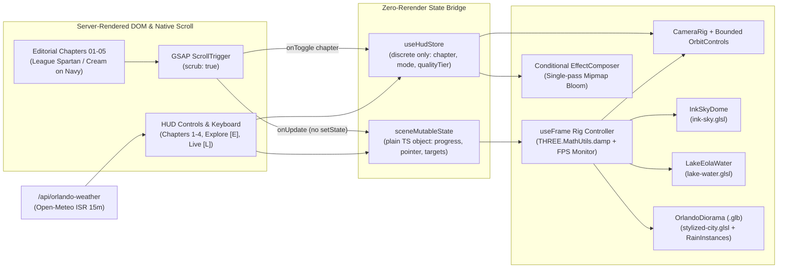

# Orlando in Ink & Light — Design Spec & Implementation Plan

> **For agentic workers:** REQUIRED SUB-SKILL: Use `superpowers:subagent-driven-development` (recommended) or `superpowers:executing-plans` to implement this plan task-by-task **only after explicit owner approval**. Steps use checkbox (`- [ ]`) syntax for tracking.

**Goal:** Build and ship an award-caliber, 60fps interactive 3D WebGL portfolio piece depicting Lake Eola and Downtown Orlando across four scroll-driven atmospheric chapters plus an interactive Explore & Live Orlando Weather mode, styled to match `chriswander.com`.

**Architecture:** A server-rendered Next.js App Router editorial shell paints immediately in deep navy (`#0b1437`) and cream (`#fbfaf6`) with preloaded variable `League Spartan` and `Open Sans` fonts before lazy-hydrating a client-only React Three Fiber `<Canvas>`. Native scroll drives `GSAP ScrollTrigger`, which writes normalized progress into a zero-rerender mutable JS store consumed inside `useFrame` via `THREE.MathUtils.damp` to choreograph camera keyframes, directional lighting, and three custom GLSL shaders over a single Meshopt-compressed `< 250 KB` Orlando `.glb` diorama.

**Tech Stack:** Next.js 16 (App Router), React 19, TypeScript, Tailwind CSS v4, Three.js, `@react-three/fiber`, `@react-three/drei`, `@react-three/postprocessing` (tier-gated single-pass `Bloom`), `GSAP` (`ScrollTrigger`), `gltf-transform` (`meshopt`), `Leva` (dev-only), Vitest, Playwright, Lighthouse CI, deployed on Vercel.

---

## Global Constraints

- **Node & Package Manager:** Pin `"engines": { "node": "24.x" }` in `package.json`; use `npm` exclusively (`package-lock.json` is the sole lockfile; never commit `pnpm-lock.yaml` or `yarn.lock`).
- **Git & Branch Discipline:** `main` is the default release branch on GitHub and is **owner-pushed only**. All work branches (`spike/*`, `feat/*`, `fix/*`) branch from `develop` and merge back into `develop`. Keep `plan/` git-ignored.
- **LCP Protection Rule:** Never initialize hero headline or primary above-the-fold copy at `opacity: 0` on first load. Self-host and `<link rel="preload">` `league-spartan-latin-var.woff2` and `open-sans-latin-var.woff2`.
- **Brand Tokens (`chriswander.com` parity):** UI chrome strictly uses `--color-navy-950: #060a1c`, `--color-navy-900: #0b1437`, `--color-navy-800: #111c45`, `--color-cream-50: #fbfaf6`, `--color-ink: #0a1228`, `--color-dark-text-muted: #aab2cc`. Warm coral/amber and storm cyan appear only inside 3D scene lighting and sky/window shaders.
- **Zero-Rerender Scroll Loop:** Continuous scroll progress (`0..1`), pointer coordinates, and frame-damped shader values must NEVER call React `setState`. React state updates only on discrete transitions (`activeChapter`, `mode`, `qualityTier`, `reducedMotion`, `liveWeather`).
- **Hard Asset & Bundle Ceilings:** Initial HTML/JS shell `< 130 KB` gzipped; lazy WebGL/R3F chunk `< 280 KB` gzipped; `orlando-diorama.glb` `< 250 KB` (Meshopt); self-hosted fonts `< 65 KB`; total cold transfer `< 800 KB`; `< 12` draw calls and `< 45,000` triangles in the main pass.

## Review Focus

1. **Missing WebGL2 or runtime `webglcontextlost` event:** When WebGL2 creation fails or the browser fires `webglcontextlost` (e.g., GPU reset or hardware acceleration disabled), `<ExperienceRoot />` switches cleanly to `<StaticDioramaFallback />` without uncaught errors, halts the animation loop, and keeps all chapter copy and links readable.
2. **`prefers-reduced-motion: reduce` enabled on load or toggled mid-session:** Disables continuous camera scrubbing, water wave oscillation, rain particle motion, and lightning flashes (`uLightningFlash = 0`); snaps smoothly to static curated viewpoints per chapter while keeping manual chapter buttons and time-of-day presets functional.
3. **Scroll ↔ `OrbitControls` camera handoff jump:** Transitioning from `'scroll'` into `'explore'` (at scroll bottom or via `[E]` toggle) and scrolling/clicking back into `'scroll'` interpolates camera position and `OrbitControls.target` over `400ms` so the camera never snaps or fights `ScrollTrigger`.
4. **`Open-Meteo` timeout, HTTP 5xx, malformed JSON, or offline state in Live Mode:** `/api/orlando-weather` enforces a `2500ms` `AbortSignal.timeout`, validates payload ranges, and returns `{ fallback: true }` on failure so Live Mode still renders accurate `America/New_York` solar time with clear-sky defaults and a calm "Live clock · Offline sky" indicator.
5. **High-DPR thermal throttling vs. backgrounded browser tab:** Rolling FPS monitor ignores frames while `document.hidden === true` (and for `500ms` after `visibilitychange` resume) so tab-switching never triggers a false GPU tier downgrade, while genuine `< 45 FPS` over `2000ms` on an active tab steps down DPR (`[1, 2]` → `1.25` → `1.0`) and disables `Bloom` without resetting scene state.

---

## 1. Concept Decision & Tradeoffs

### Chosen Concept: **"Orlando in Ink & Light"** (Merged Stylized 3D Diorama + GLSL Shaders)

A stylized 3D architectural diorama of **Lake Eola and Downtown Orlando** rendered in `chriswander.com`'s deep-navy, warm-cream, and ink-splatter editorial identity. Native scroll choreographs a single continuous camera flight through four atmospheric acts—**01 Sunrise on Lake Eola**, **02 Golden Hour Over Orange Ave**, **03 4 PM Florida Squall**, and **04 City in Ink & Gold (Night)**—before unlocking **Act 05: Explore & Live Orlando Sky** with bounded `OrbitControls` and live Orlando solar/weather sync.

### Alternatives Considered & Why They Lost

| Candidate | Strengths | Fatal Tradeoff for This Goal | Verdict |
| --- | --- | --- | --- |
| **A. Merged: "Orlando in Ink & Light" Diorama** | Proves 3D scene graph, camera rig, `glTF`/Meshopt pipeline, GPU instancing, **and** custom GLSL shaders; stylized ink/editorial shading turns simple OSM massing into intentional art direction. | Requires coordinating camera spline + 3 shaders + `.glb` export (mitigated via OSM base + strict `< 8` hero mesh limit). | **Selected** |
| **B. Pure Realistic/Low-Poly Orlando Skyline** | Clear local storytelling and lighting progression. | Without editorial ink/cel shading, low-poly blocks look like tutorial geometry unless 20–30 hours go into Blender UV/texture baking; city shadow maps hurt mobile FPS. | Rejected |
| **C. Pure 2D Ink-Splatter Fluid Shader Hero** | Fastest build, zero Blender, effortless 60fps, tight brand match. | Only renders a 2D fullscreen quad—shows fragment math, but zero real 3D camera choreography, `glTF` pipeline, or spatial scene architecture. | Rejected |

### Goals, Non-Goals & Anti-Goals

- **Goals:** Immediate "oh, that's cool" within 2 seconds; unmistakable Orlando landmarks; rock-solid 60fps on mid-range laptops (M1 Air / Intel Iris Xe) and smooth 30–60fps on mobile; readable, accessible, public production codebase worthy of senior frontend/creative-tech review.
- **Non-Goals:** Street-level photorealism, multi-mile Greater Orlando sprawl (strictly bounded to Lake Eola + Downtown core ~1.2 km radius), physics-engine collisions, or multiplayer/database state.
- **Anti-Goals (Failure even if working):** Blocking first paint behind a `%` loading spinner before showing typography; hijacking native touch scroll with laggy virtual scrollbars; shipping bloated multi-megabyte textures or uncompressed `.glb` files; visual clutter that breaks `chriswander.com`'s editorial restraint.

---

## 2. Stack & Architectural Refinements

| Layer | Choice | Refinement & Rationale |
| --- | --- | --- |
| **App Shell & Routing** | Next.js 16 (App Router) + TypeScript + Tailwind v4 | Server-renders semantic HTML chapters and preloaded variable fonts for `< 1.5s` LCP before `<Canvas>` chunk downloads; hosts cached `/api/orlando-weather` (`revalidate: 900`). |
| **Scroll Choreography** | Native Scroll + `GSAP ScrollTrigger` + `useFrame` damping | **Challenged `ScrollSmoother`:** Transforming a full-page DOM wrapper (`#smooth-content`) over a fullscreen WebGL canvas causes dual compositor pressure and breaks CSS `position: sticky`. Native scroll stays crisp while `THREE.MathUtils.damp` inside `useFrame` smooths camera and shader uniforms at 60fps. |
| **Model Compression** | `gltf-transform` with **Meshopt** (`EXT_meshopt_compression`) | **Challenged Draco:** Draco ships a ~200 KB WASM decoder to unpack a ~200 KB city mesh. Meshopt's decoder is ~20 KB and decodes 5–10x faster with near-identical quantized compression. |
| **Postprocessing** | `@react-three/postprocessing` single-pass mipmap `Bloom` | **Tier-gated:** Enabled only on `high` and `medium` GPU tiers for night windows, fountain glow, and lightning spikes; completely unmounted (`EffectComposer` bypassed) on `low` tier and mobile battery-saver contexts. |
| **Dev Tooling** | `Leva` behind `process.env.NODE_ENV === 'development'` (dynamic import) | Allows real-time tuning of shader colors, sun angles, and camera waypoints during development while tree-shaking to **0 bytes** in production bundles. |

---

## 3. MVP vs. Stretch Scope

### MVP (Must Ship for Launch)
1. **Editorial HTML Shell & Brand Parity:** Preloaded self-hosted `League Spartan` + `Open Sans`, `mix-blend-mode: difference` top bar, 4 narrative scroll chapters + Act 5 Explore dock, semantic reduced-motion & no-WebGL fallback.
2. **Stylized Orlando Diorama (`.glb`, `< 250 KB`):** OSM-seeded Downtown Orlando footprints + Lake Eola shoreline + **Linton E. Allen Fountain** + **6 hero landmarks** (200 S Orange, Bank of America Center, 55 West, The Vue at Lake Eola, Kia Center silhouette, City Hall dome), Meshopt-compressed.
3. **Three Custom GLSL Shaders:**
   - `InkSkyMaterial`: Procedural dawn/golden/storm/night sky dome + organic FBM ink-bleed reveal mask.
   - `LakeWaterMaterial`: Analytical ripples, cursor wake disturbance, storm raindrop concentric rings, Fresnel skyline reflection, and stylized ink-foam shoreline edge.
   - `StylizedCityMaterial`: Editorial navy/cream rim-and-cel shading + procedural world-space illuminated night windows + `fwidth` architectural ink-crease lines.
4. **Storm Particle Pass:** Single-draw-call GPU-instanced rain streaks + stochastic `uLightningFlash` uniform envelope during Chapter 03.
5. **Explore Dock & Live Orlando Mode:** Bounded `OrbitControls`, manual time/weather pills, keyboard shortcuts (`1–4`, `E`, `L`), and keyless `Open-Meteo` + `America/New_York` live Orlando sync.
6. **Adaptive Quality & Verification:** GPU tier detection (`detect-gpu` + rolling FPS monitor), Lighthouse CI + bundle size check + Playwright E2E accessibility/fallback suite.

### Explicit Stop Condition for MVP
Once all 6 MVP items pass the Section 6 performance/accessibility gates on desktop + real iOS/Android mobile, **cut v1.0 release before touching any Stretch item**.

### Stretch Goals (Post-v1.0 Only)
- **Stretch 1 — Procedural Web Audio Soundscape:** Synthesized/looped gentle Lake Eola fountain water, distant afternoon thunder, and rain hiss via Web Audio API (strictly opt-in mute/unmute pill, zero autoplay).
- **Stretch 2 — I-4 & SunRail Light Ribbons:** Instanced emissive curve trails gliding along the I-4 / SunRail corridor at dusk and night.
- **Stretch 3 — Interactive Landmark Pins:** `<Html>` / screen-projected minimalist callouts in Explore Mode showing architectural facts (height, year, style) when clicking the 6 hero Orlando buildings.

---

## 4. Scene & Application Architecture

### System Dataflow Diagram



### Planned Repository File Structure

```text
orlando-webgl/
├── assets-src/
│   ├── osm/
│   │   ├── fetch-orlando-osm.mjs        # Queries Overpass bbox around Lake Eola (28.536..-81.386)
│   │   └── orlando-footprints.geojson   # Cached raw footprints + heights for reproducible builds
│   └── blender/
│       └── README.md                    # Exact Blender import/scale/vertex-attribute & export checklist
├── docs/
│   └── IMPLEMENTATION_PLAN.md           # This specification and milestone plan
├── public/
│   ├── fonts/
│   │   ├── league-spartan-latin-var.woff2
│   │   └── open-sans-latin-var.woff2
│   ├── images/
│   │   ├── poster-fallback.webp         # High-craft static render for no-WebGL / SSR poster (< 65 KB)
│   │   └── ink-splatter.png             # Subtle ambient DOM accent matching chriswander.com
│   └── models/
│       └── orlando-diorama.glb          # Meshopt-compressed scene (< 250 KB)
├── scripts/
│   ├── optimize-glb.mjs                 # gltf-transform weld + quantize + meshopt + budget assertion
│   └── check-budgets.mjs                # Fails CI if .glb, fonts, or .next chunks exceed byte budgets
├── src/
│   ├── app/
│   │   ├── api/orlando-weather/route.ts # Cached Open-Meteo proxy + validation + fallback
│   │   ├── globals.css                  # Tailwind v4 @theme tokens matching chriswander.com
│   │   ├── layout.tsx                   # Font preloads, metadata, OpenGraph
│   │   └── page.tsx                     # Server-rendered narrative chapters + ExperienceLoader
│   ├── components/
│   │   ├── dom/
│   │   │   ├── TopNav.tsx               # mix-blend-mode: difference header + back-to-portfolio link
│   │   │   ├── ScrollChapters.tsx       # Semantic <section> acts 01–05 with ARIA landmarks
│   │   │   ├── SceneHud.tsx             # Chapter pills, Explore [E], Live Orlando [L], quality badge
│   │   │   └── StaticDioramaFallback.tsx# Accessible poster + chapter switcher when WebGL unavailable
│   │   └── canvas/
│   │       ├── ExperienceRoot.tsx       # WebGL2 check, context-loss listener, dynamic <Canvas> mount
│   │       ├── SceneDirector.tsx        # Master useFrame loop: damps state, updates uniforms & camera
│   │       ├── CameraRig.tsx            # CatmullRom spline + slerp handoff to bounded OrbitControls
│   │       ├── OrlandoDiorama.tsx       # useGLTF + MeshoptDecoder + StylizedCityMaterial assignment
│   │       ├── LakeEolaWater.tsx        # Basin mesh + pointer raycast plane + LakeWaterMaterial
│   │       ├── InkSkyDome.tsx           # Inverted sphere/fullscreen sky + InkSkyMaterial
│   │       ├── StormSystem.tsx          # InstancedBufferGeometry rain streaks + lightning envelope
│   │       ├── PostEffects.tsx          # Tier-gated single-pass Bloom
│   │       └── DevTweakPanel.tsx        # Dynamic dev-only Leva controls (0 B in prod)
│   ├── lib/
│   │   ├── chapters.ts                  # Canonical camera keyframes, sun vectors & atmosphere presets
│   │   ├── gpu-tier.ts                  # WebGL2 probe, GPU tier classification & rolling FPS monitor
│   │   ├── orlando-sky.ts               # Solar elevation math for 28.5383°N, -81.3792°W + WMO weather map
│   │   ├── scene-store.ts               # sceneMutableState + discrete useHudStore (useSyncExternalStore)
│   │   └── scroll-rig.ts               # GSAP ScrollTrigger binding & reduced-motion media listener
│   └── shaders/
│       ├── chunks/
│       │   └── noise.glsl               # Shared compact 2D/3D simplex noise & hash21 helpers
│       ├── ink-sky.vert.glsl
│       ├── ink-sky.frag.glsl
│       ├── lake-water.vert.glsl
│       ├── lake-water.frag.glsl
│       ├── stylized-city.vert.glsl
│       └── stylized-city.frag.glsl
├── tests/
│   ├── unit/
│   │   ├── chapters.test.ts
│   │   ├── gpu-tier.test.ts
│   │   ├── orlando-sky.test.ts
│   │   └── scene-store.test.ts
│   └── e2e/
│       ├── experience.spec.ts           # Scroll chapters, keyboard shortcuts, Explore handoff
│       ├── accessibility.spec.ts        # prefers-reduced-motion, keyboard tab order, axe-core
│       └── fallback.spec.ts             # WebGL disabled + /api/orlando-weather 500 fallback
├── lighthouserc.json
├── next.config.ts
├── package.json
├── playwright.config.ts
└── vitest.config.ts
```

### Custom GLSL Shader Specifications

| Shader | Geometry | Key Uniforms & Attributes | Visual Output & Cost Guardrail |
| --- | --- | --- | --- |
| **`ink-sky.{vert,frag}.glsl`** (`InkSkyMaterial`) | Inverted sky sphere (`radius: 180`, 32x16 segs) | `uTime`, `uTimeOfDay`, `uStormIntensity`, `uLightningFlash`, `uInkReveal`, `uSunDir` | Interpolates 4 curated horizon/zenith ramps; layers 2-octave FBM storm clouds darkened by `uStormIntensity`; applies organic ink-splatter threshold wipe on initial load (`uInkReveal: 0 -> 1`). Max 2 FBM octaves (`1` on `low` tier). |
| **`lake-water.{vert,frag}.glsl`** (`LakeWaterMaterial`) | `lake_eola_basin` flat mesh + `aShoreDist` attribute (`0..1`) | `uTime`, `uTimeOfDay`, `uStormIntensity`, `uLightningFlash`, `uPointerWorld` (`vec2`), `uPointerActive`, `uQualityLevel` (`0\|1\|2`) | Sums 3 directional waves + radial cursor wake (`exp(-dist * 0.35) * sin(...)`) + procedural cell-hashed raindrop rings when `uStormIntensity > 0.2` (skipped if `uQualityLevel == 0`); Schlick Fresnel sky reflection + crisp `#fbfaf6` ink-foam contour where `aShoreDist < 0.06`. |
| **`stylized-city.{vert,frag}.glsl`** (`StylizedCityMaterial`) | Shared material across `skyline_context_merged` + 6 hero meshes + fountain base | Attrs: `aWindowSeed`, `aIsHero`. Uniforms: `uTimeOfDay`, `uStormIntensity`, `uLightningFlash`, `uSunDir`, `uReducedMotion` | Stepped 3-band architectural shading (`#060a1c` shadow, `#1b2a5e` mid, `#fbfaf6`/amber sunlit rim); world-space procedural window cells (`fract(vWorldPos.xy * vec2(0.55, 0.38))`) lit when `uTimeOfDay > 0.68` using per-room `hash21`; `fwidth(vNormal)` subtle ink-line crease on sharp architectural edges. **Single shader program for the whole city.** |

### How Scroll State Maps to the 3D Scene

| Scroll Range | Chapter ID & Headline | Camera Waypoint `(pos -> lookAt)` | `timeOfDay` | `stormIntensity` | Key Visual Beat |
| --- | --- | --- | --- | --- | --- |
| `0.00 – 0.25` | `dawn` — **01 / First Light on Lake Eola** | `[22, 3.5, 26] -> [0, 6, 0]` | `0.00 -> 0.25` | `0.00` | Ink mask opens over Linton E. Allen Fountain; coral/gold dawn reflection skims Lake Eola toward 200 S Orange. |
| `0.25 – 0.50` | `golden` — **02 / Golden Hour on Orange Ave** | `[-28, 22, 30] -> [-6, 14, -4]` | `0.25 -> 0.48` | `0.00 -> 0.15` | Camera climbs above The Vue; warm copper sunlight grazes 200 S Orange turrets and Bank of America's stepped spire. |
| `0.50 – 0.75` | `storm` — **03 / 4 PM Florida Squall** | `[-38, 30, -24] -> [0, 10, 0]` | `0.48 -> 0.68` | `0.15 -> 1.00 -> 0.30` | Clouds deepen to `#060a1c`; instanced rain streaks fall; concentric raindrop rings ripple Lake Eola; lightning flashes rim-light towers. |
| `0.75 – 0.90` | `night` — **04 / City in Ink & Gold** | `[32, 26, -28] -> [-2, 12, 0]` | `0.68 -> 0.92` | `0.30 -> 0.00` | Warm `#fbfaf6` and `#ffd166` procedural windows flicker on floor-by-floor; Lake Eola fountain glows emerald/cream with subtle `Bloom`. |
| `0.90 – 1.00` | `explore` — **05 / Yours to Orbit** | `[36, 28, 32] -> [0, 8, 0]` (unlocks `OrbitControls`) | User / Live | User / Live | Smooth `400ms` slerp hands control to bounded orbit, manual time/weather pills, or **Live Orlando Sky** (`Open-Meteo`). |

### 3D Asset Pipeline (OSM → Blender → Meshopt `.glb`)

1. **Extract Real Footprint Data:** Run `node assets-src/osm/fetch-orlando-osm.mjs` once to query Overpass API for `building` and `natural=water` polygons within `1.2 km` of Lake Eola (`28.5439, -81.3731`), normalizing coordinates in meters centered on the Lake Eola Fountain `(0, 0, 0)`.
2. **Blender Refinement (`orlando-diorama.blend`):**
   - Import footprints; join surrounding context blocks into **1 static mesh** (`skyline_context_merged`) with per-building `aWindowSeed` vertex color/attribute.
   - Refine crisp low-poly architectural crowns (`< 2,500` tris each) for the **6 hero landmarks** + **Linton E. Allen Fountain** (`fountain_lake_eola`) + **Lake Eola basin** (`lake_eola_basin` with shoreline distance baked to UV/attribute `aShoreDist`).
   - Zero image textures required on buildings (all shading + windows are procedural GLSL!).
3. **Automated Optimization (`npm run assets:optimize`):**
   - Runs `scripts/optimize-glb.mjs` (`@gltf-transform/core` + `@gltf-transform/functions`): `dedup()`, `weld()`, `quantize()`, `meshopt({ encoder: MeshoptEncoder, level: 'medium' })`.
   - Asserts output `public/models/orlando-diorama.glb` is `< 250 KB`, total triangles `< 45,000`, and mesh node count `<= 10`.

---

## 5. Technical Risks & De-Risking Spikes

Run these **three time-boxed spikes** on `spike/*` branches (or inside Milestone 0) before investing in full Blender landmark detailing:

| Rank | Risk | Failure Symptom | De-Risking Spike (Time-Boxed) | Fallback / Pivot if Spike Fails |
| --- | --- | --- | --- | --- |
| **1 (Highest)** | **OSM → Blender scale, origin, and draw-call creep** | 400 separate building meshes imported into R3F = 400 draw calls, crooked shoreline, or `> 2 MB` `.glb`. | **Spike A (90 min):** Fetch Orlando GeoJSON, extrude/merge into 1 context mesh + 1 water plane + 1 placeholder fountain, run `optimize-glb.mjs`, verify `< 150 KB` and `<= 4` draw calls in `r3f-perf` / `renderer.info.render.calls`. | Generate the merged context city directly in a build-time Node script (`geojson -> BufferGeometry -> gltf-transform .glb`) and model only the 6 hero crowns + fountain in Blender. |
| **2** | **Retina / Integrated GPU fragment fill-rate in Water + Sky + Bloom** | Fullscreen `dpr: 2` on 16" MacBook (`3456x2234`) drops to `35 FPS` during Chapter 03 Storm when FBM sky + water ripples + `Bloom` overlap. | **Spike B (90 min):** Mount all 3 GLSL materials + single-pass `Bloom` on greybox geometry at `dpr: 1.75`; profile GPU frame time (`< 11ms` budget on M1 Air, `< 16ms` throttled). | Cap max DPR at `1.75` (`1.25` on `medium`, `1.0` on `low`), prebake 128x128 tileable noise lookup texture (`4 KB`) instead of computing ALU simplex noise per fragment, and disable raindrop ripple loop on `medium/low`. |
| **3** | **React 19 + Next.js 16 + `@react-three/fiber` / `postprocessing` peer resolution** | Hydration mismatch, duplicate `three` instances, or React reconciler version clash during `npm install` / `next build`. | **Spike C (45 min):** Scaffold Next.js 16 + R3F v9 + Drei + Postprocessing with `npm install`, run `npm ls three` (assert single version) and `npm run build` clean. | Pin exact compatible R3F v9 / `postprocessing` versions or invoke Three's lightweight native `UnrealBloomPass` / custom single-downsample mipmap bloom shader directly in `useFrame` (saves ~45 KB bundle too!). |
| **4** | **Scroll ↔ `OrbitControls` camera snap/fight** | User unlocks `OrbitControls`, rotates 120°, then scrolls slightly upward and camera teleports violently back to spline. | Addressed in `CameraRig.tsx` design: maintain explicit `handoffBlend` (`0..1` damped over `400ms`) slerping quaternion + lerping position between last orbit pose and current spline pose. | Auto-scroll smoothly back to `0.88` threshold when clicking "Resume Tour" rather than raw scroll takeover. |
| **5** | **WebGL bundle delaying LCP** | `three` chunk blocks main thread before hero headline paints. | Enforce `next/dynamic(..., { ssr: false })` wrapped in `requestIdleCallback` / post-paint `useEffect`, keeping hero `<h1>` pure server HTML + preloaded variable `woff2`. | Delay `<Canvas>` hydration until `afterPaint` (`requestAnimationFrame` x2). |

---

## 6. Performance Budget, Accessibility & Graceful Degradation

### Hard Budgets & Automated Gates

| Metric / Asset | Hard Budget | How It Is Checked |
| --- | --- | --- |
| **Initial HTML + JS Shell (pre-WebGL)** | `<= 130 KB` gzipped | `node scripts/check-budgets.mjs` inspects `.next` build manifest |
| **Async 3D / R3F / Three Chunk** | `<= 280 KB` gzipped | `node scripts/check-budgets.mjs` |
| **`public/models/orlando-diorama.glb`** | `<= 250 KB` compressed | `scripts/optimize-glb.mjs` + `scripts/check-budgets.mjs` |
| **Self-hosted Variable Fonts (2 `.woff2`)** | `<= 65 KB` combined | `scripts/check-budgets.mjs` |
| **Poster Fallback (`poster-fallback.webp`)** | `<= 65 KB` | `scripts/check-budgets.mjs` |
| **Draw Calls / Triangles (Main Pass)** | `<= 12` calls / `<= 45,000` tris | Dev HUD assertion (`gl.info.render`) + E2E telemetry hook `window.__SCENE_METRICS__` |
| **Desktop FPS (Mid-range Laptop)** | `60 FPS` steady (`p95 frame <= 16.7ms`) | Rolling 120-frame monitor in `gpu-tier.ts` + manual Chrome DevTools GPU trace |
| **Mobile FPS (Mid-range iOS / Android)** | `>= 30–60 FPS` steady, zero crashes | Real iPhone Safari + Android Chrome smoke matrix |
| **Lighthouse Performance / A11y** | Perf `>= 92` (Desktop), `>= 85` (Mobile); A11y `100` | `npx @lhci/cli autorun` (`lighthouserc.json`) |
| **Core Web Vitals** | `LCP <= 1.5s`, `CLS <= 0.02`, `INP <= 100ms` | Lighthouse CI + Vercel Speed Insights |

### Adaptive Quality Tiers (`src/lib/gpu-tier.ts`)

| Tier | Trigger Condition | `dpr` Clamp | `Bloom` | Rain Instances | Water Ripples | Antialias |
| --- | --- | --- | --- | --- | --- | --- |
| **`high`** | Desktop Apple Silicon / discrete GPU (`tier >= 3`) | `[1, 1.75]` | Enabled (1-pass mipmap) | `1,200` | Full waves + cursor + storm rings | MSAA / native |
| **`medium`** | Integrated laptop GPU / modern flagship mobile (`tier == 2`) | `[1, 1.25]` | Enabled (low threshold) | `500` | Waves + cursor only | Off (shader `fwidth` AA) |
| **`low`** | Older mobile / weak GPU / auto-downgraded after `< 45 FPS` for `2s` | `[1, 1]` | Unmounted | `150` | Simplified 2-wave analytical | Off |
| **`fallback`** | Missing WebGL2, software SwiftShader, or `webglcontextlost` | N/A (No `<Canvas>`) | N/A | N/A | N/A | High-craft `<StaticDioramaFallback />` |

### Accessibility Contract
- **`prefers-reduced-motion: reduce`:** Automatically sets `reducedMotion = true`. Camera transitions step cleanly between static chapter compositions (no continuous scroll-scrub flight), lightning flashes are suppressed (`uLightningFlash = 0`), rain streaks freeze into subtle static architectural hatch lines or hide, and CSS spin/pulse animations stop.
- **No-WebGL Readability:** `<ScrollChapters />` lives in real semantic HTML (`<main>`, `<article>`, `<h1>`–`<h2>`) styled with accessible high-contrast navy/cream scrims (`>= 7:1` AAA body contrast). Disabling JavaScript or WebGL still renders the full story over `poster-fallback.webp`.
- **Keyboard Operability:**
  - `1`, `2`, `3`, `4` — Smooth-scroll (or jump under reduced motion) to Chapters 01–04.
  - `E` — Toggle Explore Mode (`OrbitControls` + arrow-key azimuth/elevation nudge + `+`/`-` zoom so keyboard-only users can orbit without a mouse!).
  - `L` — Toggle Live Orlando Sky & Weather.
  - Visible `2px solid #fbfaf6` `:focus-visible` outlines on every interactive control; `<Canvas>` is marked `aria-hidden="true"` while an `aria-live="polite"` status region announces active chapter and Live Orlando weather changes.

---

## 7. Milestone & Task Plan

> **Branching workflow for execution:** Cut each milestone on `feat/m<N>-<slug>` branched off `develop`, run all milestone checks, merge (`--no-ff` or fast-forward per preference) into `develop`, and push `origin develop`. Never touch `main`.

### Milestone 0: Scaffold, Brand Shell & De-Risking Spikes (`feat/m0-scaffold-and-spikes`)

#### Task 0.1: Next.js 16 + TypeScript + Tailwind v4 + R3F Clean Scaffold & Budget Harness
**Files:**
- Create: `package.json`, `next.config.ts`, `tsconfig.json`, `postcss.config.mjs`, `vitest.config.ts`, `playwright.config.ts`, `lighthouserc.json`
- Create: `src/app/globals.css`, `src/app/layout.tsx`, `src/app/page.tsx`
- Create: `public/fonts/league-spartan-latin-var.woff2`, `public/fonts/open-sans-latin-var.woff2`, `public/images/ink-splatter.png` (copied from `/Users/chriswander/Codebases/vite-portfolio/public/`)
- Create: `scripts/check-budgets.mjs`

**Interfaces:**
- Produces: Next.js App Router build with `"engines": { "node": "24.x" }`, Tailwind v4 `@theme` brand tokens (`--color-navy-950`, `--color-navy-900`, `--color-cream-50`, `--color-ink`, `--font-display`, `--font-sans`), raw `.glsl` import rule in `next.config.ts` (Turbopack + webpack `raw-loader`/asset-source), and `npm run test`, `npm run typecheck`, `npm run check:budgets`.

- [ ] **Step 1: Scaffold `package.json` with pinned Node `24.x` and install core + R3F + test dependencies via `npm install`**
  Verify single Three.js instance:
  Run: `npm ls three`
  Expected: Exactly one resolved `three` version across `@react-three/fiber`, `@react-three/drei`, and `@react-three/postprocessing` (completes **Spike C**).
- [ ] **Step 2: Copy self-hosted variable fonts and `ink-splatter.png` from `/Users/chriswander/Codebases/vite-portfolio/public/` and wire `src/app/globals.css` + `src/app/layout.tsx` preloads**
  Ensure hero `<h1>` renders immediately at `opacity: 1` (LCP rule).
- [ ] **Step 3: Implement `scripts/check-budgets.mjs` asserting font (`<= 65 KB`), model (`<= 250 KB` if present), and initial JS (`<= 130 KB` gzipped) ceilings**
- [ ] **Step 4: Run verification suite**
  Run: `npm run typecheck && npm run build && node scripts/check-budgets.mjs`
  Expected: Clean production build, all byte budgets PASS.
- [ ] **Step 5: Commit on `feat/m0-scaffold-and-spikes`**

---

### Milestone 1: State Bridge, GPU Tiering & Editorial Scroll Shell (`feat/m1-state-and-editorial-shell`)

#### Task 1.1: Canonical Chapters, Mutable Scene Store & Rolling FPS / GPU Tier Monitor
**Files:**
- Create: `src/lib/chapters.ts`
- Create: `src/lib/scene-store.ts`
- Create: `src/lib/gpu-tier.ts`
- Test: `tests/unit/chapters.test.ts`, `tests/unit/scene-store.test.ts`, `tests/unit/gpu-tier.test.ts`

**Interfaces:**
- Produces:
  - `CHAPTERS: readonly ChapterPreset[]` and `sampleScrollTimeline(progress: number): TimelineSample` in `src/lib/chapters.ts`
  - `sceneMutableState`, `useHudStore()`, `setHudState(partial)`, `resetSceneState()` in `src/lib/scene-store.ts`
  - `detectInitialQualityTier(gl?: WebGL2RenderingContext | null): QualityTier` and `createRollingFpsMonitor(onDowngrade: (nextTier: QualityTier) => void)` in `src/lib/gpu-tier.ts`

- [ ] **Step 1: Write failing unit tests in `tests/unit/chapters.test.ts`, `tests/unit/scene-store.test.ts`, and `tests/unit/gpu-tier.test.ts`**
  Include **Review Focus #1 & #5** tests:
  - `detectInitialQualityTier(null)` returns `'fallback'`; software renderer string `/SwiftShader|llvmpipe/i` returns `'fallback'`.
  - `createRollingFpsMonitor` downgrades `'high' -> 'medium' -> 'low'` when fed `2100ms` of `30ms` frames while `isDocumentHidden: false`, and **does NOT downgrade** when `isDocumentHidden: true` or within `500ms` after visibility resume.
  - Mutating `sceneMutableState.scrollProgress` triggers **0** `useHudStore` subscriber notifications; changing `activeChapter` triggers exactly **1**.
- [ ] **Step 2: Run tests to verify failure**
  Run: `npx vitest run`
  Expected: FAIL (modules missing).
- [ ] **Step 3: Implement `chapters.ts`, `scene-store.ts`, and `gpu-tier.ts`**
- [ ] **Step 4: Run tests to verify pass**
  Run: `npx vitest run`
  Expected: PASS (100% green).
- [ ] **Step 5: Commit**

#### Task 1.2: Editorial HTML Chapters, `TopNav`, `SceneHud`, `StaticDioramaFallback` & `GSAP ScrollTrigger` Binding
**Files:**
- Create: `src/lib/scroll-rig.ts`
- Create: `src/components/dom/TopNav.tsx`, `src/components/dom/ScrollChapters.tsx`, `src/components/dom/SceneHud.tsx`, `src/components/dom/StaticDioramaFallback.tsx`
- Modify: `src/app/page.tsx`
- Create: `public/images/poster-fallback.webp` (initial stylized placeholder poster `< 65 KB`, replaced with final diorama render in M6)

**Interfaces:**
- Consumes: `CHAPTERS`, `sceneMutableState`, `useHudStore`, `setHudState`
- Produces: Complete accessible HTML page with 5 sections, `GSAP ScrollTrigger` progress writer (`bindScrollRig(containerEl)`), `prefers-reduced-motion` media query sync, keyboard shortcuts (`1–4`, `E`, `L`), and `<StaticDioramaFallback />`.

- [ ] **Step 1: Write Playwright tests in `tests/e2e/fallback.spec.ts` and `tests/e2e/accessibility.spec.ts` covering Review Focus #1 & #2**
  - When WebGL is stubbed to return `null`, `<StaticDioramaFallback />` renders with all 4 chapter descriptions, zero `pageerror` events, and `axe-core` passes with 0 violations.
  - With `page.emulateMedia({ reducedMotion: 'reduce' })`, `useHudStore` reports `reducedMotion: true` and pressing keys `1`–`4` navigates chapters without smooth-scroll motion sickness.
- [ ] **Step 2: Run Playwright tests to verify failure**
  Run: `npx playwright test tests/e2e/fallback.spec.ts tests/e2e/accessibility.spec.ts`
  Expected: FAIL.
- [ ] **Step 3: Implement `scroll-rig.ts`, DOM components, and `page.tsx`**
- [ ] **Step 4: Run Playwright + Vitest**
  Run: `npx vitest run && npx playwright test tests/e2e/fallback.spec.ts tests/e2e/accessibility.spec.ts`
  Expected: PASS.
- [ ] **Step 5: Commit**

---

### Milestone 2: R3F Canvas, Camera Spline & Bounded Orbit Handoff (`feat/m2-canvas-and-camera-rig`)

#### Task 2.1: Lazy `<ExperienceRoot />`, `SceneDirector` & Smooth `CameraRig` Handoff
**Files:**
- Create: `src/components/canvas/ExperienceRoot.tsx`
- Create: `src/components/canvas/SceneDirector.tsx`
- Create: `src/components/canvas/CameraRig.tsx`
- Create: `src/components/canvas/DevTweakPanel.tsx`
- Test: `tests/e2e/experience.spec.ts`

**Interfaces:**
- Consumes: `sceneMutableState`, `useHudStore`, `sampleScrollTimeline`, `detectInitialQualityTier`, `createRollingFpsMonitor`
- Produces: Lazy-mounted R3F `<Canvas>`, `webglcontextlost` recovery to `'fallback'` (**Review Focus #1**), `THREE.MathUtils.damp` uniform/time loop, and `CameraRig` with `400ms` quaternion/target slerp between scroll spline and bounded `OrbitControls` (**Review Focus #3**), plus arrow-key/+/- keyboard orbit support in Explore Mode.

- [ ] **Step 1: Extend `tests/e2e/experience.spec.ts` with tests for scroll progression, `[E]` Explore toggle, smooth camera handoff (`window.__SCENE_METRICS__.cameraJumpDelta < 0.5` on mode switch), and dispatched `webglcontextlost` event switching cleanly to `<StaticDioramaFallback />`**
- [ ] **Step 2: Run E2E test to verify failure**
  Run: `npx playwright test tests/e2e/experience.spec.ts`
  Expected: FAIL.
- [ ] **Step 3: Implement `ExperienceRoot.tsx`, `SceneDirector.tsx`, `CameraRig.tsx` (greybox Lake Eola disc + placeholder tower boxes), and dev-only `DevTweakPanel.tsx`**
- [ ] **Step 4: Run E2E + production build check (verifying `leva` is absent from `.next/static/chunks` in prod)**
  Run: `npx playwright test tests/e2e/experience.spec.ts && npm run build && node scripts/check-budgets.mjs`
  Expected: PASS.
- [ ] **Step 5: Commit**

---

### Milestone 3: Custom GLSL Shaders & Florida Storm System (`feat/m3-glsl-shaders-and-storm`)

#### Task 3.1: `InkSkyMaterial`, `LakeWaterMaterial`, `StylizedCityMaterial` & `StormSystem` (Completes Spike B)
**Files:**
- Create: `src/shaders/chunks/noise.glsl`
- Create: `src/shaders/ink-sky.vert.glsl`, `src/shaders/ink-sky.frag.glsl`
- Create: `src/shaders/lake-water.vert.glsl`, `src/shaders/lake-water.frag.glsl`
- Create: `src/shaders/stylized-city.vert.glsl`, `src/shaders/stylized-city.frag.glsl`
- Create: `src/components/canvas/InkSkyDome.tsx`, `src/components/canvas/LakeEolaWater.tsx`, `src/components/canvas/StormSystem.tsx`, `src/components/canvas/PostEffects.tsx`

**Interfaces:**
- Consumes: `sceneMutableState` (`dampedTimeOfDay`, `dampedStormIntensity`, `inkReveal`, `lightningFlash`, `pointerNDC`), `QualityTier`, `reducedMotion`
- Produces: `createStylizedCityMaterial(): THREE.ShaderMaterial` (reused in M4), live sky/water/storm shaders, pointer-raycast water ripples, instanced rain streaks (`1200` / `500` / `150` by tier, hidden under `reducedMotion`), and tier-gated single-pass mipmap `Bloom`.

- [ ] **Step 1: Add shader compilation & uniform reactivity assertions to `tests/e2e/experience.spec.ts`**
  Assert `gl.info.programs.length <= 6`, zero WebGL shader compile warnings in console, `uLightningFlash === 0` when `reducedMotion === true`, and `PostEffects` unmounted when `qualityTier === 'low'`.
- [ ] **Step 2: Run Playwright test to verify failure**
  Run: `npx playwright test tests/e2e/experience.spec.ts`
  Expected: FAIL.
- [ ] **Step 3: Implement GLSL shaders + `InkSkyDome`, `LakeEolaWater`, `StormSystem`, and `PostEffects`**
- [ ] **Step 4: Profile GPU frame time (Spike B gate) and run E2E suite**
  Run: `npx playwright test`
  Expected: PASS; main-pass draw calls `<= 10`, zero console/WebGL errors.
- [ ] **Step 5: Commit**

---

### Milestone 4: OSM → Blender → Meshopt Orlando Diorama Pipeline (`feat/m4-orlando-diorama-glb`)

#### Task 4.1: OSM Footprint Extractor, Meshopt Optimizer & `<OrlandoDiorama />` Integration (Completes Spike A)
**Files:**
- Create: `assets-src/osm/fetch-orlando-osm.mjs`, `assets-src/osm/orlando-footprints.geojson`, `assets-src/blender/README.md`
- Create: `scripts/generate-base-diorama.mjs` (deterministic programmatic builder that generates a clean, geographically accurate Lake Eola + 6 sculpted Orlando landmark crowns + merged downtown context `.glb` straight from `orlando-footprints.geojson`, which can also be opened and further hand-polished in Blender at any time!)
- Create: `scripts/optimize-glb.mjs`
- Create: `public/models/orlando-diorama.glb`
- Create: `src/components/canvas/OrlandoDiorama.tsx`

> **Why include `scripts/generate-base-diorama.mjs` alongside Blender docs?** It guarantees a 100% reproducible, geographically accurate Orlando + Lake Eola `.glb` in source control immediately (zero manual blocker), while exporting clean named collections (`fountain_lake_eola`, `lake_eola_basin`, `tower_200_s_orange`, `tower_bank_of_america`, `tower_55_west`, `tower_vue_lake_eola`, `tower_city_hall`, `skyline_context_merged`) that open cleanly in Blender for optional artisanal sculpting and re-export through `npm run assets:optimize`.

**Interfaces:**
- Consumes: `createStylizedCityMaterial()` from M3, `MeshoptDecoder` from `three/examples/jsm/libs/meshopt_decoder.module.js`
- Produces: `public/models/orlando-diorama.glb` (`<= 250 KB`, `<= 45,000` tris, `<= 10` meshes) and `<OrlandoDiorama />` binding `StylizedCityMaterial` + `LakeWaterMaterial` + fountain glow plume.

- [ ] **Step 1: Write budget + scene-graph tests asserting `orlando-diorama.glb` exists, is `<= 250 KB`, loads via `MeshoptDecoder`, and keeps total scene draw calls `<= 12`**
- [ ] **Step 2: Run `node scripts/check-budgets.mjs` and Playwright to verify failure**
- [ ] **Step 3: Implement `fetch-orlando-osm.mjs`, `generate-base-diorama.mjs`, `optimize-glb.mjs`, `assets-src/blender/README.md`, generate `public/models/orlando-diorama.glb`, and wire `<OrlandoDiorama />`**
- [ ] **Step 4: Run optimizer, budget check, and full Playwright suite**
  Run: `npm run assets:optimize && node scripts/check-budgets.mjs && npx playwright test`
  Expected: `.glb` `< 250 KB`, draw calls `<= 12`, all E2E tests PASS.
- [ ] **Step 5: Commit**

---

### Milestone 5: Live Orlando Solar & Weather Sync (`feat/m5-live-orlando-weather`)

#### Task 5.1: Solar Elevation Math, `/api/orlando-weather` ISR Route & Live HUD Integration
**Files:**
- Create: `src/lib/orlando-sky.ts`
- Create: `src/app/api/orlando-weather/route.ts`
- Modify: `src/components/dom/SceneHud.tsx`, `src/components/canvas/SceneDirector.tsx`
- Test: `tests/unit/orlando-sky.test.ts`, `tests/e2e/fallback.spec.ts`

**Interfaces:**
- Produces:
  - `computeOrlandoTimeOfDay(date: Date): { timeOfDay: number; localTimeLabel: string }` (anchored to `America/New_York`, `28.5383, -81.3792`)
  - `mapWmoToAtmosphere(weatherCode: number, cloudCover: number, precipitation: number): { stormIntensity: number; conditionLabel: string }`
  - `GET /api/orlando-weather` returning `{ tempF: number | null, conditionLabel: string, stormIntensity: number, timeOfDay: number, localTimeLabel: string, fallback: boolean }` with `revalidate = 900` and `2500ms` timeout (**Review Focus #4**).

- [ ] **Step 1: Write unit tests in `tests/unit/orlando-sky.test.ts` (sunrise `06:45`, solar noon, `16:15` WMO `95` thunderstorm -> `stormIntensity >= 0.85`, `23:00` night -> `timeOfDay >= 0.88`) and E2E route-abort test in `tests/e2e/fallback.spec.ts` (**Review Focus #4**)**
- [ ] **Step 2: Run Vitest + Playwright to verify failure**
- [ ] **Step 3: Implement `orlando-sky.ts`, `/api/orlando-weather/route.ts`, and Live `[L]` toggle in `SceneHud.tsx` + `SceneDirector.tsx`**
- [ ] **Step 4: Run Vitest + Playwright**
  Run: `npx vitest run && npx playwright test`
  Expected: PASS.
- [ ] **Step 5: Commit**

---

### Milestone 6: Poster Capture, Performance Gate, Docs & Launch Polish (`feat/m6-perf-audit-and-docs`)

#### Task 6.1: Final Poster Render, Lighthouse CI Gate, Architecture README & Vercel Deploy Prep
**Files:**
- Modify: `public/images/poster-fallback.webp` (captured high-res WebP `< 65 KB` directly from the finished scene)
- Modify: `README.md` (final architecture notes, shader breakdown, performance numbers, local dev commands, live demo URL)
- Modify: `vercel.json` (security headers + CSP allowing `self` + `blob:` workers if needed, matching `chriswander.com` hygiene)

- [ ] **Step 1: Capture final `poster-fallback.webp` (`<= 65 KB`) and verify `<StaticDioramaFallback />` visual parity**
- [ ] **Step 2: Run full verification gate**
  Run: `npm run typecheck && npx vitest run && npm run build && node scripts/check-budgets.mjs && npx playwright test && npx @lhci/cli autorun`
  Expected:
  - TypeScript: 0 errors
  - Vitest + Playwright (including `axe-core`, `reduced-motion`, `webglcontextlost`, `500` weather fallback): 100% PASS
  - Budgets: Initial JS `<= 130 KB` gz, 3D chunk `<= 280 KB` gz, `.glb <= 250 KB`, fonts `<= 65 KB`
  - Lighthouse: Desktop Performance `>= 92`, Accessibility `100`
- [ ] **Step 3: Update `README.md` with real measured bundle/FPS/Lighthouse metrics and commit on `feat/m6-perf-audit-and-docs`, then merge into `develop` and push `origin develop`**

---

## 8. Case Study Outline (for `chriswander.com`)

Write this after Milestone 6 ships, pulling exact numbers and screen recordings captured along the way:

1. **The Problem & Portfolio Gap**
   - Eight shipped agency client sites (Arnold Palmer Invitational, NNN REIT, Xenia Hotels, Baker Barrios) proved commercial delivery, but lived in private repos without 3D/shader work.
   - Goal: Ship an open-source, 60fps WebGL centerpiece rooted in Orlando that feels unmistakable alongside `chriswander.com` without sacrificing Core Web Vitals or accessibility.
2. **Art Direction: Why "Orlando in Ink & Light" Beat Photorealism**
   - How merging a stylized Lake Eola diorama with `chriswander.com`'s `#0b1437` navy, `#fbfaf6` cream, and ink-splatter aesthetic solved the solo-dev Blender asset trap while proving both 3D spatial choreography and custom GLSL.
3. **Architecture & Key Engineering Calls**
   - **Zero-Rerender Scroll Bridge:** Why `GSAP ScrollTrigger` writes to a plain mutable ref damped in `useFrame` instead of React state, and why native scroll beat `ScrollSmoother` over a fullscreen WebGL canvas.
   - **Meshopt over Draco:** Trading a 200 KB WASM decoder for a 20 KB decoder to cut cold-start parse time on a `< 250 KB` OSM-seeded Orlando `.glb`.
   - **Single-Program City Shader:** Using vertex attributes (`aWindowSeed`, `aIsHero`) + procedural world-space GLSL windows + `fwidth` ink creases to render downtown Orlando in `< 12` draw calls with zero image textures.
4. **The Hardest Bugs & How They Were Solved**
   - Smooth quaternion/target slerp handoff between scroll-scrubbed spline mode and free `OrbitControls` without camera snap.
   - Making the rolling FPS auto-downgrade monitor ignore background-tab `visibilitychange` frame spikes.
   - Designing a first-class `prefers-reduced-motion` and no-WebGL static editorial experience rather than an afterthought error message.
5. **Before / After Visuals to Capture During Build**
   - Raw OpenStreetMap Orlando footprint wireframe → Meshopt low-poly greybox → Final `StylizedCityMaterial` + `LakeWaterMaterial` at Night.
   - Unthrottled multi-pass postprocessing GPU flamegraph vs. single-pass tier-gated mipmap `Bloom` + procedural ink shader.
6. **Measured Results Scorecard**
   - Cold transfer size, initial JS vs. lazy WebGL split, `.glb` byte weight, draw calls, Desktop & Mobile Lighthouse scores (`LCP`, `CLS`, `INP`), and steady FPS across M-series MacBook, integrated Intel laptop, and iOS Safari.
